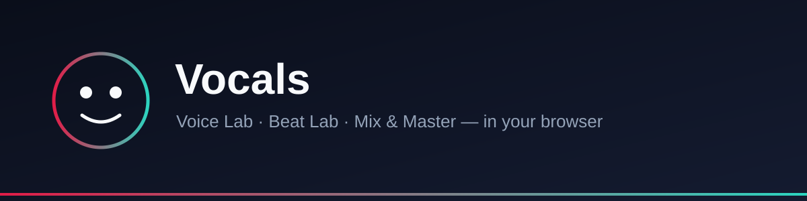

# Vocals

A modern premium web studio for voice + song creation — record or clone a voice, generate a beat, and mix & master a song, all in the browser.

## Features

- **Voice Lab** — record your voice (MediaRecorder) or upload a sample; script/lyrics editor; pronunciation fixer (`word=say-as` dictionary applied before speaking); local preview with browser voices, pitch and rate controls.
- **Beat Lab** — procedural instrumental generator (WebAudio): mood (happy/sad/chill/energetic/cinematic), genre (pop/lofi/trap/cinematic), BPM, key and seed. Same seed = same beat.
- **Mix & Master** — voice/beat gains, stereo pan, reverb, compression and normalization; offline render to a real **WAV** download. MP4/WebM recording uses your browser's MediaRecorder and is labelled with the actual format produced.
- **Bring Your Own AI** — connect any OpenAI-compatible TTS endpoint with your own API key (stored only in your browser) for studio-grade voice quality.
- **Pet companion** — Forge the orb pet reacts while you record, generate and export. Rename him anytime.

## Honest quality notes

- **Local mode** = browser TTS preview + your recorded/uploaded voice + procedural beats + real WAV mix/export. It is free, private, and needs no key — but browser TTS will sound like browser TTS.
- **Studio-grade voice cloning** comes from BYO AI mode with your own API key and endpoint. Vocals itself ships no AI model.
- AI-generated exports carry an `ai-generated` disclosure in the filename. A consent checkbox ("I own this voice or have permission to use it") gates clone/export actions.

## Usage

1. **Voice Lab** — record with your microphone or upload a voice sample, type or paste your script/lyrics, and use the pronunciation fixer (`word=say-as`) for words the voice gets wrong. Preview locally with browser voices and adjust pitch and rate.
2. **Beat Lab** — pick a mood, genre, BPM, key and seed, then generate. The same seed always produces the same beat, so note the seed to reproduce a take.
3. **Mix & Master** — set voice/beat gains, stereo pan, reverb, compression and normalization, then render offline and download the WAV. Video recording (MP4/WebM) uses your browser's MediaRecorder and is labelled with the format actually produced.
4. **Bring Your Own AI (optional)** — connect any OpenAI-compatible TTS endpoint with your own API key for studio-grade voice quality. The key is stored only in your browser. Tick the consent checkbox ("I own this voice or have permission to use it") to unlock clone/export actions; AI-generated exports carry an `ai-generated` disclosure in the filename.

Everything runs locally in your browser — no account, no uploads, no key required for local mode.

## Run it

Open `index.html` in a modern browser, or serve the folder:

```bash
npx serve .
```

## Tests

```bash
node --test tests/
```

## Credits

Created by **Priyanshu Kumar Thakur (Gravion)**. Pet companion: Forge.

## License

MIT
